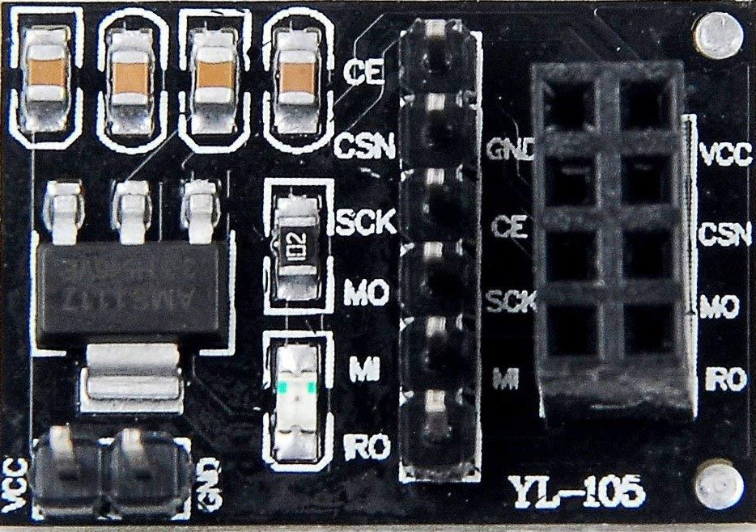

# Leksjon 1 – Bygg og test
### Navn: _______________________________

**Kodefil:** `Leksjon1_RadioTest.ino`

## Del 1 – Montering

- [ ] Arduino UNO R4 WiFi er plassert i boksen og montert med T-plugger
- [ ] Breadboard er plassert i boksen
- [ ] NRF24L01 er koblet til  HW-200 adapter og plassert i antenneholder
    - **OBS:** Det kan være lettere å sette i kablene før du plasserer antennen i boksen

**Pinoppsett – NRF24L01-adapter til Arduino:**

<table>
<tr>
<td valign="top">

| Adapter | Arduino |
|---|---|
| VCC | 5V |
| GND | GND |
| CE | Pin 9 |
| CSN | Pin 10 |
| SCK | Pin 13 |
| MISO | Pin 12 |
| MOSI | Pin 11 |
| IRQ | Ikke i bruk |

</td>
<td valign="top">



</td>
</tr>
</table>

> **Tilkoblinger:**  
- [ ] NRF24L01-adapter koblet til Arduino med 7 kabler
- [ ] Jord (GND) fra Arduino til øvre blå linje på breadboard
    - [ ] Tips: Snu breadboardet slik at den blå linja er nederst. Se bilde nedenfor.
- [ ] Buzzer er koblet til **Pin 3** (+) og **GND** (–)
- [ ] Knapp A er koblet til **Pin 2** og **GND**
- [ ] Knapp B er koblet til **Pin 4** og **GND**
- [ ] USB-kabel er koblet mellom Arduino og PC


---

## Del 2 – Kallenavn

Hver boks har et kallenavn. Det er navnet boksen bruker på radioen, og det er slik
de andre boksene og HUB vet hvem dere er.

- [ ] Vi har fått en lapp med kallenavnet vårt av kursholderen. **Skriv det her:**

  **Vårt kallenavn:** &nbsp; `____________________`

- [ ] Vi har funnet gruppa vi skal snakke med, og spurt hva de heter. **Skriv det her:**

  **Partnerens kallenavn:** &nbsp; `____________________`

> **Viktig:** Disse to navnene skal dere skrive inn i koden i neste del, bokstav for bokstav.
> Koden virker ikke før det er gjort.

---

## Del 3 – Arduino IDE

- [ ] Gå til github.com/Vgsjovik/Teknaradio
- [ ] Lastet ned og åpnet filen `Leksjon1_RadioTest.ino` i Arduino IDE
- [ ] Valgt riktig kort: **Tools → Board → Arduino UNO R4 WiFi**
- [ ] Valgt riktig port: **Tools → Port** */dev/cu.usbmodem...*
- [ ] To biblioteker er installert (**Tools → Manage Libraries**, søk på navnet):
    - [ ] **RF24** (av TMRh20)
    - [ ] **ArduinoGraphics**
- [ ] Funnet disse to linjene øverst i koden:

    ```cpp
    #define KALLENAVN "ALFA"
    #define PARTNER   "BRAVO"
    ```

- [ ] Byttet `ALFA` med **vårt kallenavn** fra Del 2
- [ ] Byttet `BRAVO` med **partnerens kallenavn** fra Del 2
    - `ALFA` og `BRAVO` er bare eksempler. Ingen boks heter det.
    - La anførselstegnene stå. Store og små bokstaver spiller ingen rolle.
- [ ] Lastet opp koden til Arduino (**Upload**-knappen)


---

## Del 4 – Oppstart

Boksen tester seg selv hver gang den starter. Trykk *reset* for å se det en gang til.
På bildet er reset-knappen den røde knappen rett ved USB-kabelen. På deres enhet er knappen hvit og flat.

- [ ] Koden kompilerer uten feil (ingen røde meldinger i Arduino IDE)
- [ ] Matrisen viser `V` + 1 pip: radioen svarer
- [ ] Matrisen viser `K` + 2 pip: HUB hører dere
- [ ] Navnet deres har fått hake under «HUB hører deg» på tavla
- [ ] Haken under «Godkjent kallenavn» kommer når partneren også er på nett,
      og dere har skrevet hverandres navn i koden
- [ ] Serial Monitor er åpnet (**Tools → Serial Monitor**, 9600 baud) og viser `Kallenavn:` og `Partner:`

| Ser du | Betyr | Gjør dette |
|---|---|---|
| `X` som blir stående | Radioen svarer ikke | Sjekk de sju kablene til radioen. Boksen prøver på nytt hvert sekund, og viser `V` når det er riktig. |
| `?` + 3 pip | HUB hører dere ikke | Si fra til kursholderen. Knappene virker likevel. |
| `NAVN?` som ruller | Navnet finnes ikke, eller KALLENAVN og PARTNER er like | Har dere byttet ut ALFA og BRAVO med navnene fra Del 2? Se i Serial Monitor: der står lista over gyldige navn. |

---

## Del 5 – Knappene

- [ ] Trykket **Knapp A** → skjermen til partneren tennes, med melodi *opp*.
      Hos dere selv høres bare et kort klikk.
- [ ] Trykket **Knapp B** → skjermen til partneren slukkes, med melodi *ned*
- [ ] Partneren tenner og slukker skjermen deres
- [ ] Se på tavla mens dere trykker. Hva viser den?

---

## Refleksjonsspørsmål

> **Spørsmål:** Ved oppstart sender boksen en melding til HUB *og* får en kvittering
> tilbake (ACK). Det er den som gir `K`. Hva er forskjellen på *å sende* og *å få bekreftelse
> på at meldingen kom fram*? Fikk dere noen kvittering da dere tente skjermen til partneren?
>
> Svar: _______________________________________________
>
> _______________________________________________

---

## Ferdig!

Når alle boksene er krysset av og navnet deres står på tavla:

**→ Gå videre til Leksjon 2**
